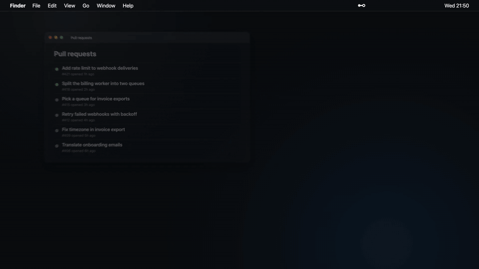

# Hither

Every coding agent that needs you, and every pull request, in your menu bar.



```bash
brew install --cask erenbekman/tap/hither
```

A macOS menu bar app. When Claude Code or Codex (and, in beta, Copilot CLI or opencode) stops to ask for permission or an answer, Hither puts it at the top of the panel, counts it in the menu bar and brings its terminal forward with one shortcut. Next to your agents: the pull requests waiting on you, your checks, deploys and production errors.

## Why Hither

- **Agents that need you, first.** A "Needs you" strip lists every waiting agent, longest wait first. The menu bar counts them, and one reminder comes when an agent has waited two minutes.
- **One shortcut to the right terminal.** ⌥⌘J from any app brings the waiting agent's terminal forward, the exact tab in iTerm and Ghostty; press again for the next agent. Keep the terminal you use: iTerm, Terminal, Ghostty or Warp.
- **Pull requests the way GHBar shows them.** Review requests, changes requested, merge conflicts, ready to merge, mentions and new activity on your own pull requests; check out a branch from its row.
- **What happens after you merge.** A red main branch, failed checks, Laravel Forge deploys and new Sentry errors.
- **One click into Claude Code.** A failed build or deploy becomes a Claude Code session in your terminal, with the deploy log attached.
- **Yours.** Every lane can be turned off. Nothing leaves your Mac except the calls Hither makes to GitHub, Forge and Sentry. Free and open source (MIT).

More in [docs/PLAN.md](docs/PLAN.md).

## Install

Install with the Homebrew command above, or download the notarized `.dmg` from [Releases](https://github.com/erenbekman/hither/releases). It runs on Apple silicon and Intel Macs and updates itself from there. Sign in with GitHub on first launch, or let Hither use the [GitHub CLI](https://cli.github.com) account.

## Development

Requires Node and Rust. Release builds are universal and need rustup with both macOS targets (`brew install rustup`, then `rustup target add aarch64-apple-darwin x86_64-apple-darwin`).

```bash
npm install
npm run tauri dev
npm test
npm run tauri build
```

## Releasing

```bash
TAURI_SIGNING_PRIVATE_KEY_PASSWORD=… scripts/release.sh "Release notes"
```

The script signs with the Developer ID certificate, notarizes and staples the app and the disk image with the `hither-notary` keychain profile, signs the update with `~/.tauri/hither.key`, and writes the universal DMG, `Hither.app.tar.gz`, `latest.json` and the Homebrew cask to `release/<version>/`. Publishing is left to you.

## License

MIT. See [LICENSE](LICENSE).

## Credits

Panel design and architecture inspired by [GHBar](https://github.com/cobanov/ghbar) by Mert Çobanov (MIT). See [NOTICE](NOTICE).
